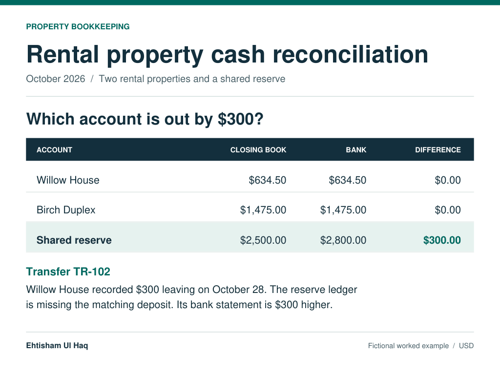

# Rental property cash reconciliation

[Download the Excel workbook](https://github.com/Ehtisham514/apex-reconciliation-toolkit/raw/refs/heads/main/templates/rental-property/Rental_Property_Cash_Reconciliation.xlsx)

I built this workbook to answer two questions a rental owner can have at month-end. Why did a property need to borrow before rent arrived? Which account is missing the other side of a transfer?

## Follow the cash

In the fictional October example, Willow House opens with $600. Its $1,550 mortgage comes due on October 2, three days before rent arrives. A $1,100 credit draw leaves $150 after the mortgage payment. The Ledger shows the postings in order.

On October 28, Willow records a $300 transfer to the shared reserve. The reserve's closing bank balance is $2,800 and its books show $2,500. Filter the **Review** column on the Ledger to find **TR-102**. To try the correction in a copy, enter the matching receipt on October 29 with **Shared reserve** as the account, **Transfer** as the category, **300** as the amount, **TR-102** as the ID and **Willow House** as the other account. The difference falls to zero. On a live file, check the receiving statement for the posting date and amount.

## Use it for a monthly close

Start with a fresh copy. Replace the month, account names, opening book balances and closing bank balances on **Summary**. Clear the fictional entries in **Ledger** columns A–G and enter your own posted transactions. Each copy supports six accounts and 150 entries in USD.
